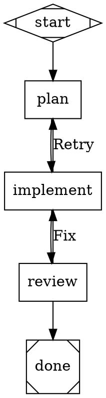

# Reactor

Reactor is a C#/.NET implementation of [StrongDM's Attractor](https://github.com/strongdm/attractor): you describe a
multi-stage AI workflow as a Graphviz **DOT** graph, and Reactor runs it — calling coding agents at each stage,
routing on outcomes, retrying, pausing for human approval, fanning out in parallel, and checkpointing so any run can
be resumed.

It implements all three Attractor specs:

| Spec | Reactor project | What it is |
|---|---|---|
| [Attractor](https://github.com/strongdm/attractor/blob/main/attractor-spec.md) | `Reactor.Core` (`src/Reactor`) | DOT parser, validation, execution engine, handlers, checkpoints, human gates, events |
| [Coding Agent Loop](https://github.com/strongdm/attractor/blob/main/coding-agent-loop-spec.md) | `Reactor.Agent` | Agentic loop with provider-aligned tool sets (apply_patch, edit_file, shell, grep, …), subagents |
| [Unified LLM Client](https://github.com/strongdm/attractor/blob/main/unified-llm-spec.md) | `Reactor.Llm` | One client for OpenAI (Responses API), Anthropic, Gemini, and OpenAI-compatible endpoints |

On top of that it adds stage **backends** for the GitHub Copilot SDK, the GitHub Copilot CLI, and Claude Code, an
**HTTP server** with a web console, and the `reactor` command-line tool.



```text
$ reactor run examples/smoke.dot --backend copilot --model gpt-5-mini
backend: GitHub Copilot SDK, default model gpt-5-mini
▶ Pipeline 'test_pipeline' — Create a hello world Python script
● plan [codergen]
✔ plan success (11.7s)
● implement [codergen]
  │ → create hello.py
✔ implement success (7.8s)
● review [codergen]
  │ → view hello.py
✔ review success (11.1s)
✔ Pipeline completed (success) in 30.7s
  logs:   .reactor/runs/20260718-192803-test_pipeline
```

## Quick start

Requirements: the .NET 10 SDK. Optional: [Graphviz](https://graphviz.org) for graph rendering, and whichever agent
backend you want to use (see below).

```powershell
git clone <this repository> reactor && cd reactor
dotnet build -c Release
dotnet run --project src/Reactor.Cli -- doctor          # what backends/tools are available?
dotnet run --project src/Reactor.Cli -- run examples/smoke.dot --backend simulate
```

`reactor` can also be installed as a .NET tool: `dotnet pack src/Reactor.Cli -c Release` then
`dotnet tool install -g Reactor.Cli --add-source src/Reactor.Cli/bin/Release`. The package bundles the GitHub
Copilot runtime for the platform it was built on; elsewhere, point `COPILOT_CLI_PATH` at a runtime or use the other
backends.

### Backends

Each `codergen` stage (a `box` node) is handed to a **backend**. Pick one with `--backend` (default `auto`):

| Backend | Uses | Needs |
|---|---|---|
| `agent` | Reactor's own coding agent loop (Coding Agent Loop spec) | `OPENAI_API_KEY`, `ANTHROPIC_API_KEY`, `GEMINI_API_KEY`/`GOOGLE_API_KEY`, or `OPENAI_COMPATIBLE_BASE_URL` |
| `direct` | One LLM call per stage, no tools (planning/review stages) | same as `agent` |
| `copilot` | GitHub Copilot SDK (runtime bundled with the CLI) | a GitHub account with Copilot (signed in via `copilot`) |
| `copilot-cli` | the `copilot` CLI as a subprocess | `copilot` on PATH |
| `claude-code` | Claude Code (`claude -p`) as a subprocess | `claude` on PATH, logged in |
| `simulate` | no LLM; stages return placeholder text | nothing |

`auto` picks `agent` when an API key is set, else `copilot`, `copilot-cli`, `claude-code`, then `simulate`.
Individual nodes can override the default with `backend="copilot-cli"` or route by `llm_provider` — see
[docs/backends.md](docs/backends.md).

To use a local model, point `OPENAI_COMPATIBLE_BASE_URL` at an OpenAI-compatible server (llama.cpp's
`llama-server`, Ollama, vLLM, …) and run with `--backend agent --provider openai-compatible --model <name>`. Add
`--max-tokens` (e.g. 2048) and stage `timeout`s: local servers often let a response run until the context window is
full, which takes a long time when a small model starts repeating itself. Small local models handle simple stages but
are far less reliable than frontier models at multi-step coding work.

## Writing pipelines

A pipeline is a `digraph`. Node **shape** selects the handler:

| Shape | Handler | Does |
|---|---|---|
| `Mdiamond` | start | entry point (exactly one) |
| `Msquare` | exit | terminal; checks goal gates (exactly one) |
| `box` (default) | codergen | runs the stage prompt through the backend |
| `hexagon` | wait.human | asks a human to pick an outgoing edge |
| `diamond` | conditional | routes on the previous outcome/context |
| `component` | parallel | fans out to its targets concurrently |
| `tripleoctagon` | parallel.fan_in | joins parallel branches |
| `parallelogram` | tool | runs `tool_command` in a shell |
| `house` | stack.manager_loop | supervises a child pipeline |

Edges route on `condition="outcome=success"`, `condition="context.tests_passed=true && outcome!=fail"`, a
`label` matching the stage's preferred label, `weight`, and finally lexical order. Agents report non-default
outcomes by writing `status.json` in their stage directory (the prompt tells them how).

Stages can also declare the artifacts they read and produce (`inputs="spec, design"`,
`outputs="design:docs/DESIGN.md, verdict"`): prompts list them, a stage that does not write a declared file fails
(and can be retried), and each produced artifact is recorded in the context and announced as an `ArtifactProduced`
event — see [artifacts](docs/pipelines.md#artifacts-reactor-extension).

Full reference: [docs/pipelines.md](docs/pipelines.md). Examples in [examples/](examples):

| Example | Shows |
|---|---|
| [smoke.dot](examples/smoke.dot) | the spec's integration smoke test |
| [human-review.dot](examples/human-review.dot) | a human approval gate with timeout/default |
| [test-fix-loop.dot](examples/test-fix-loop.dot) | a tool node running tests, failures loop to a fixer |
| [parallel-review.dot](examples/parallel-review.dot) | parallel fan-out/fan-in |
| [stylesheet.dot](examples/stylesheet.dot) | per-node models via a CSS-like `model_stylesheet` |
| [supervisor.dot](examples/supervisor.dot) | a manager loop observing and steering a child pipeline |
| [factory.dot](examples/factory.dot) | a 15-node build/test/review/sign-off pipeline |
| [artifacts.dot](examples/artifacts.dot) | artifact pins: stages declare `inputs`/`outputs` (spec → design → code → test report → verdict) |

## Command line

```text
reactor run <file.dot>        Run a pipeline        (--backend, --model, -C <workdir>, --set k=v, --answer, -y, --json, -v/-q)
reactor resume <run-dir>      Resume from the last checkpoint
reactor validate <file.dot>   Parse and lint
reactor render <file.dot>     Render to SVG/PNG/PDF (--run <run-dir> colors stages by status)
reactor serve                 HTTP API + web console (--urls, --token, --max-concurrent)
reactor agent [prompt]        Talk to the coding agent loop directly
reactor models                List catalog models (--provider copilot: models your Copilot account can use)
reactor doctor                Check backends, credentials, and tools
```

Runs are written to `<workdir>/.reactor/runs/<timestamp>-<name>/`: `checkpoint.json`, `events.jsonl`,
`result.json`, `graph.dot`, and one directory per stage with `prompt.md`, `response.md`, `status.json`,
`backend.json` (model, tokens, cost) and agent transcripts. Exit codes: 0 success, 1 pipeline failed,
2 invalid input, 3 configuration error, 130 cancelled. Press Ctrl+C to stop gracefully; `reactor resume` continues.

## HTTP server

`reactor serve` exposes the spec's HTTP mode (section 9.5) plus a web console at `/` for watching runs live and
answering human gates:

```powershell
reactor serve --backend copilot --token $env:REACTOR_SERVER_TOKEN
curl -H "Authorization: Bearer $token" -H "Content-Type: text/vnd.graphviz" --data-binary @examples/smoke.dot http://127.0.0.1:5180/pipelines
```

Endpoints: `POST /pipelines`, `GET /pipelines/{id}`, `GET /pipelines/{id}/events` (SSE with replay),
`POST /pipelines/{id}/cancel`, `/resume`, `GET /pipelines/{id}/graph`, `/questions`,
`POST /pipelines/{id}/questions/{qid}/answer`, `/checkpoint`, `/context`, plus `POST /run`, `GET /status`,
`POST /answer`. The Studio API (`/studio/api/...`) adds a run history read from disk (including CLI runs), event
replay, per-stage telemetry across runs, forking a run from any stage, and steering a running agent. See
[docs/http-api.md](docs/http-api.md).

## Using the libraries

```csharp
using Reactor.Backends;
using Reactor.Execution;
using Reactor.Llm;

await using var client = Client.FromEnv();                       // OPENAI_API_KEY / ANTHROPIC_API_KEY / ...
await using var backend = new AgentLoopBackend(new AgentLoopBackendOptions { Client = client });
var runner = new PipelineRunner(new PipelineRunnerOptions { Backend = backend });

var result = await runner.RunAsync(File.ReadAllText("examples/smoke.dot"), new RunOptions { WorkingDirectory = "." });
Console.WriteLine($"{result.Status} — {string.Join(" → ", result.CompletedNodes)}");
```

The Unified LLM client works on its own too:

```csharp
var answer = await Ai.GenerateAsync(new GenerateOptions { Model = "claude-opus-4-6", Prompt = "Explain DOT in one line" });
```

## Repository layout

```text
src/Reactor          Reactor.Core: graph model, DOT parser, validation, engine, handlers, events, rendering
src/Reactor.Llm      Unified LLM client, provider adapters, high-level generate/stream/object APIs
src/Reactor.Agent    Coding agent loop: sessions, tools, execution environments, provider profiles, subagents
src/Reactor.Backends Codergen backends: agent loop, direct LLM, Copilot CLI, Claude Code, router, tool hooks
src/Reactor.Copilot  GitHub Copilot SDK backend
src/Reactor.Server   HTTP API, server-sent events, web console
src/Reactor.Cli      the `reactor` command
tests/               xUnit v3 test projects (one per library)
examples/            example pipelines
docs/                architecture, pipeline reference, backends, HTTP API, spec conformance
```

## Development

```powershell
dotnet build                     # warnings are errors
dotnet test                      # ~900 tests across six projects
```

Test projects are executables (xUnit v3), so a single suite can also run directly, e.g.
`tests/Reactor.Tests/bin/Debug/net10.0/Reactor.Tests.exe -class "Reactor.Tests.Engine.EngineTests"`.

Further reading: [architecture](docs/architecture.md) · [spec conformance and design decisions](docs/spec-conformance.md).
