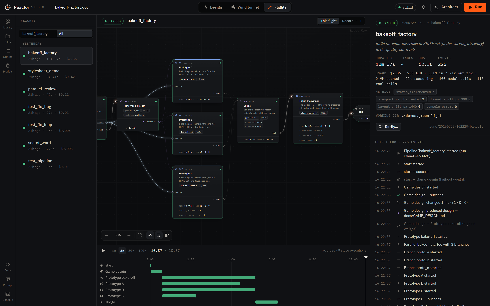
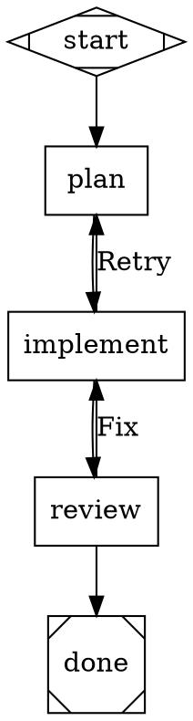
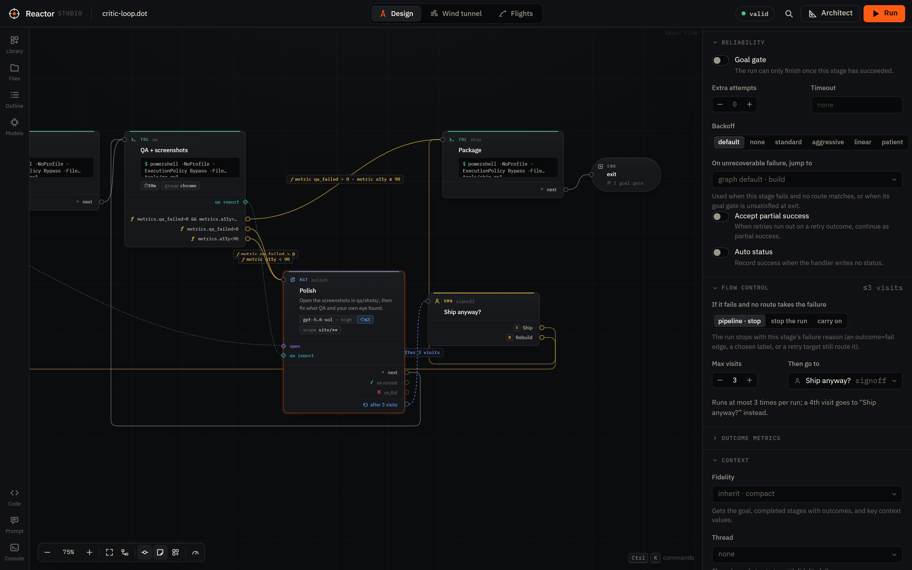
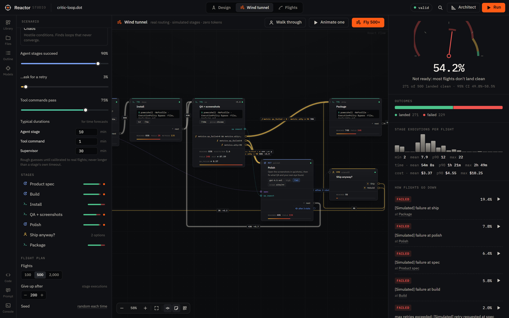
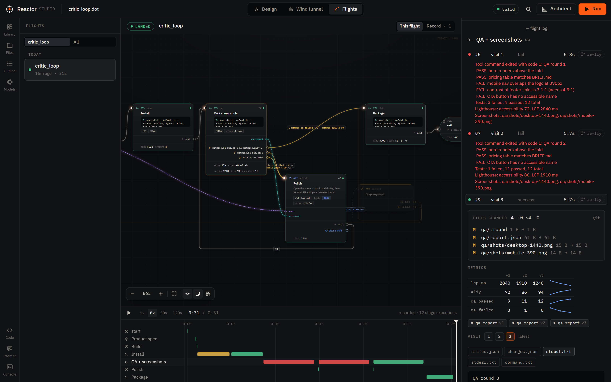
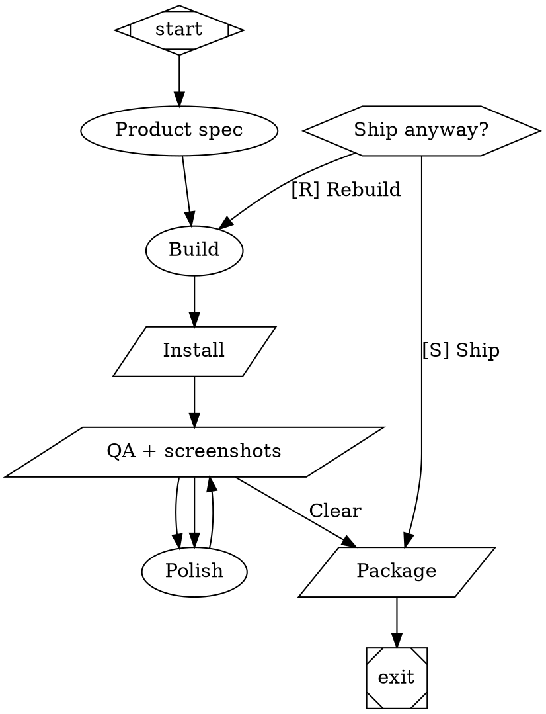

# Reactor

Reactor is a C#/.NET implementation of [StrongDM's Attractor](https://github.com/strongdm/attractor): you describe a
multi-stage AI workflow as a Graphviz **DOT** graph, and Reactor runs it — calling coding agents at each stage,
routing on outcomes, retrying, pausing for human approval, fanning out in parallel, and checkpointing so any run can
be resumed.

It implements all three Attractor specs:

| Spec | Reactor project | What it is |
|---|---|---|
| [Attractor](https://github.com/strongdm/attractor/blob/main/attractor-spec.md) | `Reactor.Core` (`src/Reactor`) | DOT parser, validation, execution engine, handlers, checkpoints, human gates, events |
| [Coding Agent Loop](https://github.com/strongdm/attractor/blob/main/coding-agent-loop-spec.md) | `Reactor.Agent` | Agentic loop with provider-aligned tool sets (apply_patch, edit_file, shell, grep, …), subagents |
| [Unified LLM Client](https://github.com/strongdm/attractor/blob/main/unified-llm-spec.md) | `Reactor.Llm` | One client for OpenAI (Responses API), Anthropic, Gemini, and OpenAI-compatible endpoints |

On top of the specs, Reactor adds what it takes to run agent factories unattended, and to measure them:

- **Stage backends**: Reactor's own agent loop, the GitHub Copilot SDK, the GitHub Copilot CLI, and Claude Code, which
  can be mixed within one pipeline.
- **[Reactor Studio](#reactor-studio)**, a visual workbench to design pipelines, fly them in a zero-token wind tunnel,
  launch and steer real runs, and read every run back, with an Architect that drafts and critiques pipelines. It runs
  on Reactor's [HTTP server](#http-server); the [`reactor` command line](#command-line) does the rest.
- **[Factory extensions](#failures-loops-and-timeouts)** to the pipeline language: failures that stop instead of
  silently flowing on, loop bounds, [outcome metrics](#outcome-metrics) you can route on (critic scores, QA counts),
  retries that hand the next attempt what the last one did, cost budgets, artifact contracts between stages, and
  [workspaces](#workspaces-and-bake-offs): what each stage changed, write scopes, and bake-off branches in their own
  git worktrees.



<sub>Reactor Studio replaying a real 3 h 16 m run that built an arcade game. Three models build prototypes in
parallel, an LLM judge plays them and picks one, and the rest of the pipeline grows the winner into the full game.</sub>



```text
$ reactor run examples/smoke.dot --backend copilot --model gpt-5-mini
backend: GitHub Copilot SDK, default model gpt-5-mini
▶ Pipeline 'test_pipeline' — Create a hello world Python script
● plan [codergen]
✔ plan success (11.7s)
● implement [codergen]
  │ → create hello.py
✔ implement success (7.8s)
● review [codergen]
  │ → view hello.py
✔ review success (11.1s)
✔ Pipeline completed (success) in 30.7s
  logs:   .reactor/runs/20260718-192803-test_pipeline
```

## Quick start

Requirements: the .NET 10 SDK. Optional: [Graphviz](https://graphviz.org) for graph rendering, and whichever agent
backend you want to use (see below).

```powershell
git clone <this repository> reactor && cd reactor
dotnet build -c Release
dotnet run --project src/Reactor.Cli -- doctor          # what backends/tools are available?
dotnet run --project src/Reactor.Cli -- run examples/smoke.dot --backend simulate
```

`reactor` can also be installed as a .NET tool: `dotnet pack src/Reactor.Cli -c Release` then
`dotnet tool install -g Reactor.Cli --add-source src/Reactor.Cli/bin/Release`. The package bundles the GitHub
Copilot runtime for the platform it was built on; elsewhere, point `COPILOT_CLI_PATH` at a runtime or use the other
backends.

### Backends

Each `codergen` stage (a `box` node) is handed to a **backend**. Pick one with `--backend` (default `auto`):

| Backend | Uses | Needs |
|---|---|---|
| `agent` | Reactor's own coding agent loop (Coding Agent Loop spec) | `OPENAI_API_KEY`, `ANTHROPIC_API_KEY`, `GEMINI_API_KEY`/`GOOGLE_API_KEY`, or `OPENAI_COMPATIBLE_BASE_URL` |
| `direct` | One LLM call per stage, no tools (planning/review stages) | same as `agent` |
| `copilot` | GitHub Copilot SDK (runtime bundled with the CLI) | a GitHub account with Copilot (signed in via `copilot`) |
| `copilot-cli` | the `copilot` CLI as a subprocess | `copilot` on PATH |
| `claude-code` | Claude Code (`claude -p`) as a subprocess | `claude` on PATH, logged in |
| `simulate` | no LLM; stages return placeholder text | nothing |

`auto` picks `agent` when an API key is set, else `copilot`, `copilot-cli`, `claude-code`, then `simulate`.
Individual nodes can override the default with `backend="copilot-cli"` or route by `llm_provider` — see
[docs/backends.md](docs/backends.md).

To use a local model, point `OPENAI_COMPATIBLE_BASE_URL` at an OpenAI-compatible server (llama.cpp's
`llama-server`, Ollama, vLLM, …) and run with `--backend agent --provider openai-compatible --model <name>`. Add
`--max-tokens` (e.g. 2048) and stage `timeout`s: local servers often let a response run until the context window is
full, which takes a long time when a small model starts repeating itself. Small local models handle simple stages but
are far less reliable than frontier models at multi-step coding work.

## Reactor Studio

```powershell
reactor studio --backend copilot      # serves the current directory and opens http://127.0.0.1:5180/
```

Reactor Studio is a visual workbench for agent factories. Its routing, validation, prompts, and simulations come from
the real engine:

- **Design** pipelines on a canvas where every route is a port (`✓ on success`, `✕ on fail`, gate options, labels,
  `ƒ metric a11y < 90` conditions, `⟲ after 3 visits` loop bounds). The canvas has groups, artifact wires, a model
  stylesheet editor with model prices, a two-way DOT editor, and an exact prompt preview. The Inspector edits every
  attribute, including timeouts, flow control, outcome metrics, and workspaces, and the validator's flow-control
  findings come with one-click fixes.
- **Wind tunnel**: fly the design hundreds of times with simulated stage outcomes (zero tokens) to find loops that
  never converge, dead ends, unreachable goal gates, and failures that silently flow on. Give stages durations, costs,
  and the metrics they report to forecast time and cost per flight, then calibrate it to your real flights to forecast
  what a change will do to the clean landing rate, time, and cost. It is also on the command line as `reactor simulate`.
- **Flights**: launch runs with a budget, answer human gates on the canvas, steer running agents, and replay any run
  (from this server or `reactor run`) on a timeline. Each stage shows every visit and attempt, including a timed-out
  agent's last words, plus its outcome metrics by visit, the files it changed, and its cost in dollars on any backend.
  Re-fly a run from just before any stage with an edited pipeline, optionally rewinding the working directory first.
  Each pipeline's flight record shows success, time, cost, where it breaks, and the trajectory of its metrics.
- **Architect**: describe a factory, or ask for a revision or a critique backed by the flight record. Each draft is
  checked by the parser, the validator, and the wind tunnel, reviewed against your brief by the model that drafted
  it, and delivered with a forecast against the current design.



<sub>**Design**: a QA → polish loop routed on outcome metrics (`metrics.qa_failed`, `metrics.a11y`) and bounded by
`max_visits=3`, which hands a fourth round to a person. The pipeline is the [critic loop](#outcome-metrics) below,
with stub tool commands.</sub>



<sub>**Wind tunnel**: 500 simulated flights of the same pipeline in under a second. About half land clean, and the
biggest failure mode is the `Package` tool stage, which has no retries. Cards show each stage's reach, failure rate, and
simulated metric averages; the right panel has the time and cost forecasts.</sub>



<sub>**Flights**: one run of that pipeline (agent stages simulated, tool stages real). The QA stage's three visits come
with their failure excerpts, its metrics improve visit by visit, and the files it changed are listed. The timeline
shows the install retry and the two failed QA rounds.</sub>

See [docs/studio.md](docs/studio.md).

## Writing pipelines

A pipeline is a `digraph`. Node **shape** selects the handler:

| Shape | Handler | Does |
|---|---|---|
| `Mdiamond` | start | entry point (exactly one) |
| `Msquare` | exit | terminal; checks goal gates (exactly one) |
| `box` (default) | codergen | runs the stage prompt through the backend |
| `hexagon` | wait.human | asks a human to pick an outgoing edge |
| `diamond` | conditional | routes on the previous outcome/context |
| `component` | parallel | fans out to its targets concurrently |
| `tripleoctagon` | parallel.fan_in | joins parallel branches |
| `parallelogram` | tool | runs `tool_command` in a shell |
| `house` | stack.manager_loop | supervises a child pipeline |

Edges route on `condition="outcome=success"`, `condition="context.tests_passed=true && outcome!=fail"`, a
`label` matching the stage's preferred label, `weight`, and finally lexical order. Reactor adds numeric comparisons
(`<`, `<=`, `>`, `>=`) and two key families: `visits.<stage>` (how many times a stage has run) and `metrics.<name>`
(the latest [outcome metric](#outcome-metrics)). Agents report non-default outcomes by writing `status.json` in their
stage directory (the prompt tells them how).

Stages can also declare the artifacts they read and produce (`inputs="spec, design"`,
`outputs="design:docs/DESIGN.md, verdict"`): prompts list them, a stage that does not write a declared file fails
(and can be retried), and each produced artifact is recorded in the context and announced as an `ArtifactProduced`
event — see [artifacts](docs/pipelines.md#artifacts-reactor-extension).

### Failures, loops, and timeouts

Per the spec, a failed stage with an unconditional edge carries on as if it had succeeded, so `a -> b -> exit` can
"succeed" even though `a` failed. Reactor flags this (`fail_flows_onward` in `reactor validate`, a
`FailedStageContinued` event, and "landed with failed stages" in the wind tunnel). With `default_on_fail="stop"` on
the graph (or `on_fail="stop"` on a stage), the run ends instead, unless a condition, label, or retry target routes
the failure.

Loops need a bound the engine enforces. Use `max_visits=3` on a stage, with `on_max_visits` naming where the run goes
instead of a fourth visit (without it, the run fails), or a condition such as `visits.polish<3`.

Retries are not blind. Each attempt is kept in `<stage>/attempts/attempt-N/` (prompt, transcript, usage, and the
agent's last words). The next attempt's prompt gets a **Previous attempt** section: how the attempt ended, what the
agent last said, and that its work is still in the working directory. Codergen prompts state the stage's time limit.
On steerable backends (`agent`, `copilot`), agents are reminded at a soft deadline (`soft_timeout`, by default 80% of
a `timeout` of 5 minutes or more). `on_timeout="wrap_up"` tells the agent its time is up and gives it `timeout_grace`
to finish before it is stopped; `on_timeout="fail"` never retries a timeout.

Tool stages run their command in a job object (Windows) or a process group of its own (`setsid`), so a timeout or a
cancel ends the whole process tree, not just the shell. Escape codes are stripped from what they record, and a failure
reason leads with the failing lines (`FAIL …`, `error TS2322`, tracebacks) rather than the tail of the output.
`reactor validate` and the Studio check all of this: failures that flow onward, loops without a bound, defaults
decided by id order, parallel branches sharing a directory, and malformed attributes. The Studio offers one-click
fixes for the flow-control findings. See [flow control](docs/pipelines.md#flow-control-reactor-extensions).

### Outcome metrics

Stages can report numbers about the product rather than the process, such as critic scores, QA pass/fail counts,
accessibility scores, or bundle size. They report them in `status.json` (`"metrics": {"score": 4}`), in
`<stage>/metrics.json`, or in a report file named by `metrics_file`. Metrics are recorded per visit, emitted as
`MetricsRecorded` events, charted in the Studio, and routable as `metrics.<name>`. Here is the critic loop from the
screenshots above. It ships when QA is clean and accessibility clears 90, polishes otherwise, and asks a person after
three polish rounds:



This is the run shown in the Flights screenshot. It used `--backend simulate`, so agent stages return placeholder text,
and stub scripts stood in for the `npm` commands: a flaky install, and a QA report that improves each round.

```text
$ reactor run critic-loop.dot --backend simulate
backend: simulation (no LLM calls)
▶ Pipeline 'critic_loop' — Build the landing page described in BRIEF.md to the quality bar it sets
  run bdf3c2b281dc · logs .reactor\runs\20260730-125358-critic_loop
● start [start]
✔ start success (0.0s)
  │ workspace snapshots use git (a private index; snapshot commits on refs/reactor/runs/bdf3c2b281dc/main)
  …
● deps [tool]
  ✖ deps: Tool command exited with code 1: npm ERR! code ETIMEDOUT npm ERR! network request to https://registry.npmjs.org/vite failed, reason: connect ETIMEDOUT (will retry)
  ↻ deps retry #2 in 0.2s
● deps [tool] attempt 2
✔ deps success (3.5s)
● qa [tool]
  ✖ qa: Tool command exited with code 1: QA round 1 … FAIL  CTA button has no accessible name Tests: 3 failed, 9 passed, 12 total …
✖ qa fail (5.8s)
  ≡ lcp_ms=2840, a11y=72, qa_passed=9, qa_failed=3
  ⇢ qa_report v1 (text, 366 B)
● polish [codergen]
✔ polish success (0.0s)
  …
● qa [tool]
✔ qa success (5.7s)
  ≡ lcp_ms=1240, a11y=94, qa_passed=12, qa_failed=0
  ⇢ qa_report v3 (text, 226 B)
● ship [tool]
✔ ship success (3.0s)
  …
✔ Pipeline completed (success) in 30.5s
  stages: start → spec → build → deps → qa → polish → qa → polish → qa → ship → exit
```

The wind tunnel needs simulated metrics for a stage that routes on them; otherwise its flights dead-end there. Set
them in the Studio's scenario panel or in a scenario file for `reactor simulate --scenario`:

```json
{ "preset": "realistic",
  "nodes": { "qa": { "metrics": { "qa_failed": { "success": 0, "fail": { "min": 1, "max": 4 } },
                                  "a11y": { "min": 70, "max": 100 } } } } }
```

See [outcome metrics](docs/pipelines.md#outcome-metrics) and [scenarios](docs/http-api.md#scenarios).

### Workspaces and bake-offs

After each stage that can change files, Reactor records what it changed in `<stage>/changes.json`. The snapshots use a
private git index (or a file walk outside git) and never touch your index, `HEAD`, or branches. You can `git diff` any
stage's work, the Studio lists it per stage, and in a git work tree Re-fly can rewind the working directory to how it
was after any stage. `write_scope="site/**"` names what a stage may change; changes outside it are a warning, or a
failure with `write_scope_enforce=true`. Stages that share a `concurrency_group` (a headless browser, a GPU, a fixed
port) never run at the same time.

Parallel branches can each get their own workspace, either a git worktree or a copy, and the fan-in can promote the
winner's changes:

```dot
bakeoff [shape=component, branch_workdir="worktree"]
proto_a [prompt="Build prototype A", llm_model="claude-opus-4.8"]
proto_b [prompt="Build prototype B", llm_model="gpt-5.6-sol"]
judge   [shape=tripleoctagon, promote="best", prompt="Play each prototype in its workspace and pick the best."]
bakeoff -> proto_a -> judge
bakeoff -> proto_b -> judge
```

See [workspaces](docs/pipelines.md#workspaces-reactor-extension).

### Standing instructions

House rules for agents go in the graph's (or a stage's, or a stylesheet rule's) `instructions` attribute. Every backend
honors them on top of a small built-in set (`house_rules=false` turns that off). See
[standing instructions](docs/pipelines.md#standing-instructions-reactor-extension).

### Reference and examples

Full reference: [docs/pipelines.md](docs/pipelines.md). Examples in [examples/](examples):

| Example | Shows |
|---|---|
| [smoke.dot](examples/smoke.dot) | the spec's integration smoke test |
| [human-review.dot](examples/human-review.dot) | a human approval gate with timeout/default |
| [test-fix-loop.dot](examples/test-fix-loop.dot) | a tool node running tests; failures loop to a fixer, bounded by `max_visits` |
| [parallel-review.dot](examples/parallel-review.dot) | parallel fan-out/fan-in (`branch_workdir` picks a shared or an isolated workspace per branch) |
| [stylesheet.dot](examples/stylesheet.dot) | per-node models via a CSS-like `model_stylesheet` |
| [supervisor.dot](examples/supervisor.dot) | a manager loop observing and steering a child pipeline |
| [factory.dot](examples/factory.dot) | a 15-node build/test/review/sign-off pipeline; a fix loop that does not converge goes to the human (`on_max_visits`) |
| [artifacts.dot](examples/artifacts.dot) | artifact pins: stages declare `inputs`/`outputs` (spec → design → code → test report → verdict) |

## Command line

```text
reactor run <file.dot>        Run a pipeline        (--backend, --model, -C <workdir>, --set k=v, --answer, -y, --json, -v/-q, --logs <dir>, --max-cost <usd>, --no-track-changes)
reactor resume <run-dir>      Resume from the last checkpoint (same flags; --max-cost raises a budget the run stopped at)
reactor validate <file.dot>   Parse and lint (--simulate: every simulated happy-path flight must land)
reactor simulate <file.dot>   Fly it in the wind tunnel: many simulated runs, zero tokens
                              (--runs 1000, --scenario happy|realistic|stress|chaos|<file.json>, --seed, --max-steps,
                               --min-success 0.95, --trace <run>, --set k=v, --json)
reactor render <file.dot>     Render to SVG/PNG/PDF/DOT (-o graph.png picks the format; --run <run-dir> colors stages by status)
reactor serve                 HTTP API + Reactor Studio + console (--urls, --token, --max-concurrent, --max-cost,
                              --allow-client-workdir, and run's backend flags)
reactor studio                Same server, and opens the Studio in a browser
reactor agent [prompt]        Talk to the coding agent loop directly
reactor models                List catalog models with their token prices (--provider copilot: models your Copilot
                              account can use, priced from Reactor's Copilot price table; REACTOR_PRICES=<file> overrides it)
reactor doctor                Check backends, credentials, and tools
```

Runs are written to `<workdir>/.reactor/runs/<timestamp>-<name>/` (the timestamp is UTC, `yyyyMMdd-HHmmss`, as for
runs started by the server). With `--logs <dir>` they go to that directory instead, and nothing is created under
`<workdir>/.reactor`. A run directory holds:

- `checkpoint.json`, `events.jsonl`, `result.json`, `graph.dot`, and every stage's checkpoint under `checkpoints/`, so
  the Studio can re-fly a CLI run from any stage;
- one directory per stage with `prompt.md`, `response.md`, `status.json`, `instructions.md` (the stage's standing
  instructions), agent transcripts, and `backend.json`, which records the model, tokens, and cost in native units plus
  a comparable `cost_usd`, including for attempts that time out or fail;
- in a stage's directory, `attempts/attempt-N/` for each retried attempt, `history/visit-N/` for earlier visits in a
  loop, and `changes.json` when it can change files (`--no-track-changes` turns workspace snapshots off for a run).

The run summary ends with the run's usage totals: cost, AI units or premium requests, and tokens, with failed and
timed-out attempts included. `--max-cost <usd>` (or the graph's `max_cost`) stops a run, resumably, before its next
stage once its recorded cost reaches the budget; `reactor resume <run-dir> --max-cost <more>` continues it. Exit
codes: 0 success, 1 pipeline failed, 2 invalid input, 3 configuration error, 130 cancelled. Press Ctrl+C to stop
gracefully; `reactor resume` continues.

While parallel branches run, every activity line names the stage it comes from (in a color of its own unless
`--no-color` or `NO_COLOR` is set), so concurrent agents stay apart:

```text
● proto_a [codergen]
● proto_b [codergen]
  │ proto_a: copilot-cli session 358962f6-… (claude-sonnet-5)
  │ proto_b: copilot-cli session 4e960be1-… (gpt-5.6-sol)
  │ proto_b → view docs/GAME_DESIGN.md
```

`reactor render <file.dot> --run <run-dir>` colors the stages of a run: finished stages by their latest status (from
`checkpoint.json` and `events.jsonl`), and the stages executing now — several while parallel branches run, none once
the run has ended — as running. The output format follows `-o`'s extension (`.svg`, `.png`, `.pdf`, `.jpg`, `.gif`,
`.json`, `.ps`, `.eps`, or `.dot`/`.gv` for the display DOT, which needs no Graphviz); `-f` must agree with it.

`reactor simulate` is the Studio's wind tunnel from the command line: it flies the pipeline through the real engine
with simulated stage outcomes (no model calls, no tool commands) and prints the readiness gauge — the **clean landing
rate** with its 95% interval, and the flights that landed with failed stages behind them — how flights go down (each
failure group with the stage and a replayable run), hot spots and loops, and simulated time and cost per flight. The
presets assume rough typical stage durations (agents 10 min, tools 1 min, supervisors 30 min); a scenario file can
start from a preset and set per-stage `duration_ms`, `cost` (USD per run), outcome `metrics`, and more (see
[http-api.md](docs/http-api.md#scenarios)):

```powershell
reactor simulate factory.dot --scenario realistic --min-success 0.95   # CI gate: exit 1 below 95% clean landings
reactor simulate factory.dot --seed 4242 --trace 17                    # replay flight 17 of that report, event by event
reactor simulate factory.dot --scenario my-scenario.json --json        # the report as POST /studio/api/simulate returns it
reactor validate factory.dot --simulate                                # exit 2 if any happy-path flight cannot land
```

```text
$ reactor simulate examples/factory.dot --scenario realistic --seed 7
Wind tunnel: factory · realistic scenario · 1,000 flights · seed 7 · flown in 3.2s

Readiness
  Landed clean                93.1%   95% CI 91.4%–94.5%   931 of 1,000
  Landed with failed stages   0.0%    0 flights
  Did not land                6.9%    69 flights

How flights go down
  failed · 1.6% (16): [Simulated] failure at implement
      at implement · replay run 13
  …
Hot spots (visits per flight)
  route         ×2.06   max 13
  test          ×2.06   max 13   515 retries
  …
Stage executions per flight   mean 24.2 · p50 18 · p90 43 · max 124
Simulated time per flight     mean 2h 01m · p50 1h 33m · p90 3h 34m · max 9h 37m
Simulated cost per flight     not modeled (set "cost" per stage in a scenario file)
```

`reactor simulate` exits 1 when the clean landing rate is below `--min-success`, and 2 on an invalid pipeline or
scenario.

## HTTP server

`reactor serve` exposes the spec's HTTP mode (section 9.5), Reactor Studio at `/`, and the classic web console at
`/console` for watching runs live and answering human gates:

```powershell
reactor serve --backend copilot --token $env:REACTOR_SERVER_TOKEN
curl -H "Authorization: Bearer $token" -H "Content-Type: text/vnd.graphviz" --data-binary @examples/smoke.dot http://127.0.0.1:5180/pipelines
```

Endpoints: `POST /pipelines`, `GET /pipelines/{id}`, `GET /pipelines/{id}/events` (SSE with replay),
`POST /pipelines/{id}/cancel`, `/resume`, `GET /pipelines/{id}/graph`, `/questions`,
`POST /pipelines/{id}/questions/{qid}/answer`, `/checkpoint`, `/context`, plus `POST /run`, `GET /status`,
`POST /answer`. The Studio API (`/studio/api/...`) adds parsing with editor metadata, prompt previews, workspace
files, a run history read from disk (including CLI runs), event replay, per-stage telemetry across runs, forking a run
from any stage, steering a running agent, Monte Carlo simulation, and the Architect. See
[docs/http-api.md](docs/http-api.md).

## Using the libraries

```csharp
using Reactor.Backends;
using Reactor.Execution;
using Reactor.Llm;

await using var client = Client.FromEnv();                       // OPENAI_API_KEY / ANTHROPIC_API_KEY / ...
await using var backend = new AgentLoopBackend(new AgentLoopBackendOptions { Client = client });
var runner = new PipelineRunner(new PipelineRunnerOptions { Backend = backend });

var result = await runner.RunAsync(File.ReadAllText("examples/smoke.dot"), new RunOptions { WorkingDirectory = "." });
Console.WriteLine($"{result.Status} — {string.Join(" → ", result.CompletedNodes)}");
```

The Unified LLM client works on its own too:

```csharp
var answer = await Ai.GenerateAsync(new GenerateOptions { Model = "claude-opus-4-6", Prompt = "Explain DOT in one line" });
```

## Repository layout

```text
src/Reactor          Reactor.Core: graph model, DOT parser, validation, engine, handlers, events, rendering
src/Reactor.Llm      Unified LLM client, provider adapters, high-level generate/stream/object APIs
src/Reactor.Agent    Coding agent loop: sessions, tools, execution environments, provider profiles, subagents
src/Reactor.Backends Codergen backends: agent loop, direct LLM, Copilot CLI, Claude Code, router, tool hooks
src/Reactor.Copilot  GitHub Copilot SDK backend
src/Reactor.Server   HTTP API, server-sent events, Studio API and hosting, web console
src/Reactor.Studio   Reactor Studio web app (React, TypeScript, React Flow), embedded into Reactor.Server
src/Reactor.Cli      the `reactor` command
tests/               xUnit v3 test projects (one per library, and one for the CLI)
examples/            example pipelines
docs/                architecture, pipeline reference, backends, Studio, HTTP API, spec conformance
```

## Development

```powershell
dotnet build                     # warnings are errors; builds and embeds the Studio when Node.js 20.19+ is installed
dotnet test                      # ~1,400 tests across seven projects
cd src/Reactor.Studio; npm test  # Studio unit tests (Vitest)
```

Skip the Studio build with `-p:SkipStudio=true` (or `REACTOR_SKIP_STUDIO=1`); see [docs/studio.md](docs/studio.md#building-the-studio).
Test projects are executables (xUnit v3), so a single suite can also run directly, e.g.
`tests/Reactor.Tests/bin/Debug/net10.0/Reactor.Tests.exe -class "Reactor.Tests.Engine.EngineTests"`.

Further reading: [architecture](docs/architecture.md) · [spec conformance and design decisions](docs/spec-conformance.md).
