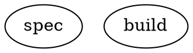

# Pipeline reference

A Reactor pipeline is a Graphviz `digraph`. This page lists everything the engine understands; anything else is
ignored by the engine (and still rendered by Graphviz).

## DOT subset

- One `digraph` (optionally `strict`) per file; node ids are identifiers (`[A-Za-z_][A-Za-z0-9_]*`) or quoted strings.
- `graph [...]`, `node [...]`, `edge [...]` default blocks; top-level `key = value` graph attributes.
- Chained edges `a -> b -> c [label="x"]` create one edge per pair, all with the attributes.
- Subgraphs are flattened. Defaults declared inside a subgraph apply only inside it, and a subgraph `label` becomes a
  stylesheet class for its nodes (`label="Deep thinking"` → `.deep-thinking`).
- Values: quoted strings (with `\"`, `\n` escapes and `+` concatenation), identifiers, numbers, `true`/`false`, and
  durations (`250ms`, `30s`, `5m`, `2h`, `1d`).
- Comments: `//`, `/* */`, and `#` at the start of a line.

Errors report line and column: `reactor validate file.dot`.

## Graph attributes

| Attribute | Default | Meaning |
|---|---|---|
| `goal` | `""` | The pipeline goal; `$goal` in prompts expands to it, and it is mirrored to `graph.goal` in context. |
| `label` | `""` | Display name. |
| `model_stylesheet` | `""` | CSS-like rules assigning `llm_model`, `llm_provider`, `reasoning_effort`, and `instructions` (see below). |
| `instructions` | `""` | Reactor extension: standing instructions ("house rules") for every LLM stage, on every backend (see [Standing instructions](#standing-instructions-reactor-extension)). |
| `house_rules` | `true` | Reactor extension: `false` leaves out Reactor's built-in house rules. |
| `default_max_retries` | `0` | Extra attempts for nodes without `max_retries` (legacy alias `default_max_retry`). |
| `retry_target` / `fallback_retry_target` | `""` | Where to jump when a goal gate is unsatisfied at exit, or a failed node has nowhere to go. |
| `default_fidelity` | `compact` | Context carried into codergen prompts (see fidelity). |
| `default_thread_id` / `thread_id` | | Thread for `full` fidelity stages. |
| `stack.child_dotfile`, `stack.child_workdir` | | Child pipeline for manager nodes. |
| `tool_hooks.pre`, `tool_hooks.post` | | Shell commands around each agent tool call (see hooks). |
| `default_on_fail` | `continue` | Reactor extension: `stop` ends the run when a stage fails and nothing routes the failure (see [Flow control](#flow-control-reactor-extensions)). |
| `max_cost` | | Reactor extension: budget in US dollars; the run stops, resumably, before its next stage once recorded cost reaches it (see [Usage and budgets](#usage-and-budgets)). |
| `track_changes` | `true` | Reactor extension: record what each stage changed in its working directory (`changes.json`); `false` turns snapshots off for this pipeline (see [Workspaces](#workspaces-reactor-extension)). |

## Node attributes

| Attribute | Default | Meaning |
|---|---|---|
| `shape` | `box` | Selects the handler (table below). |
| `type` | | Explicit handler type; overrides `shape`. Custom handlers register under a type string. |
| `label` | node id | Display name; for `hexagon` nodes, the question text. |
| `prompt` | label | Task for codergen stages. `$goal` is expanded. |
| `max_retries` | graph default | Additional attempts on `retry`/`fail` outcomes or retryable errors. |
| `retry_policy` | | Preset backoff: `none`, `standard`, `aggressive`, `linear`, `patient`. |
| `goal_gate` | `false` | The pipeline may only exit once this node has succeeded. |
| `retry_target`, `fallback_retry_target` | | Per-node override of the graph's targets. |
| `timeout` | | Stage time limit (e.g. `10m`); the stage fails when exceeded (and is retried per `max_retries`, with a hand-off). Codergen prompts state the limit. |
| `on_timeout` | `retry` | Reactor extension: `retry` (a timeout is retried like other transient errors), `fail` (never retried), or `wrap_up` (the agent is told time is up and gets `timeout_grace` to finish first; steerable backends). |
| `soft_timeout`, `timeout_grace` | 80% of `timeout` (if ≥ 5m); 10% of `timeout` (1–15m) | Reactor extension: when to remind an agent that time is running out (`off` disables), and the `wrap_up` grace period. |
| `max_visits`, `on_max_visits` | | Reactor extension: the most times the stage may run in one run, and where the run goes instead once that is used up (unset: the run fails). |
| `on_fail` | graph `default_on_fail` | Reactor extension: `stop` or `continue` — what an unrouted failure of this stage does. |
| `metrics_file` | | Reactor extension: a JSON report (relative to the working directory) whose numbers are recorded as the stage's [outcome metrics](#outcome-metrics). |
| `llm_model`, `llm_provider`, `reasoning_effort` | `reasoning_effort=high` for reasoning models | Model selection for the stage (usually via the stylesheet); see [backends](backends.md) for how each backend applies the effort. |
| `fidelity`, `thread_id` | | Context carry-over mode and conversation thread. |
| `class` | | Comma-separated stylesheet classes. |
| `auto_status` | `false` | Record SUCCESS automatically when the handler writes no status. |
| `allow_partial` | `false` | When retries are exhausted on `retry`, accept `partial_success` instead of failing. |
| `backend` | | Reactor extension: route this stage to a named backend (`agent`, `direct`, `copilot`, `copilot-cli`, `claude-code`). |
| `inputs` | | Reactor extension: artifacts the stage reads, e.g. `inputs="spec, design"` (see [Artifacts](#artifacts-reactor-extension)). |
| `outputs` | | Reactor extension: artifacts the stage produces — `name` (its final response, or a tool's stdout) or `name:path` (a file it must write), e.g. `outputs="design:docs/DESIGN.md, verdict"`. |
| `instructions` | | Reactor extension: standing instructions for this stage, added after the graph's (also settable from the stylesheet). |
| `house_rules` | graph setting | Reactor extension: `false`/`true` turns the built-in house rules off or on for this stage. |
| `write_scope` | | Reactor extension: comma-separated globs, relative to the working directory, the stage may change (`prototypes/proto_a/**`); changes outside it are logged as a warning and listed in `changes.json` (see [Workspaces](#workspaces-reactor-extension)). |
| `write_scope_enforce` | `false` | Reactor extension: a successful stage that changed files outside its `write_scope` fails instead (not retried). |
| `concurrency_group` | | Reactor extension: stages with the same group name never run at the same time within a run (e.g. browser-based QA in parallel branches). |
| `track_changes` | graph's | Reactor extension: `false` skips this stage's snapshots; `true` records it even when the graph turned tracking off. |

### Handler-specific attributes

| Handler (shape) | Attributes |
|---|---|
| wait.human (`hexagon`) | `human.timeout`, `human.default_choice` (target id, key, or label), `human.input="freeform"` with `human.question` |
| parallel (`component`) | `join_policy` = `wait_all` (default; `partial_success` if any branch fails) or `first_success` (cancels the other branches once one succeeds); `max_parallel` (default 4); `branch_workdir` = `shared` (default), `worktree`, or `copy` (each branch gets its own workspace, see [Workspaces](#workspaces-reactor-extension)). Branch context changes are not merged back, except [artifact records](#artifacts-reactor-extension) |
| fan-in (`tripleoctagon`) | optional `prompt`: an LLM picks the best branch (reply `BEST: <id>`); otherwise ranked by status and score. A judge (a fan-in with a `prompt`) takes `inputs` and `outputs` like a codergen stage — e.g. `outputs="verdict, judgement:prototypes/JUDGEMENT.md"` records its answer and a report file it must write — and its `backend.json` records the judge's model, usage, and decision (`fan_in_method`, `fan_in_best_id`). `promote="best"`: apply the winning branch's workspace changes to the fan-in's working directory |
| tool (`parallelogram`) | `tool_command` (run with `cmd.exe /c` on Windows, `bash -c` elsewhere); `timeout` (default 10m); produced `inputs` arrive as `REACTOR_INPUT_<NAME>` file paths; `tool_color` (default `false`; see [Tool stages](#tool-stages)) |
| manager (`house`) | `manager.poll_interval` (45s), `manager.max_cycles` (1000), `manager.stop_condition`, `manager.actions` (`observe,wait`; add `steer`), `manager.steer_cooldown` (5m), `manager.steer_prompt`, `stack.child_autostart`, `stack.child_logs_root` |
| codergen with the `agent` backend | `agent.max_tool_rounds` (default 200), `agent.max_turns`, `agent.max_tokens` (output tokens per response), `agent.instructions` (legacy; prefer `instructions`, which every backend honors), `agent.shell_timeout` |

### Tool stages

A tool stage runs `tool_command` in the run's working directory and succeeds when it exits with code 0. Its output is
written to `stdout.txt` and `stderr.txt` in the stage directory and exposed as `tool.output` and `tool.stderr` (see
[Context](#context)); a bare `outputs` name records stdout as a text artifact.

- **Plain text.** The command runs with `NO_COLOR=1`, `FORCE_COLOR=0`, and `TERM=dumb`, so test runners and build tools
  print without colors. Escape sequences that remain (colors, cursor movement, hyperlinks, window titles) are stripped
  from everything recorded, progress lines rewritten with carriage returns keep their last state, and when that changed
  the output, the raw capture is kept next to it in `stdout.raw.txt` / `stderr.raw.txt`. Set `tool_color=true` to leave
  the color-related environment alone (output is still stripped).
- **Failure reasons.** A command that exits non-zero fails with `Tool command exited with code N: <excerpt>`. Short
  output is quoted whole. Longer output (stdout, then stderr) is reduced to the lines that look like failures — failing
  tests (`FAIL`, `×`, `✘`), compiler errors (`error TS2322`), exceptions (`TypeError:`), tracebacks, panics,
  `npm ERR!`, non-zero failure counts — each with a line of context before and two after, de-duplicated, in order, and
  ahead of the last lines of the output, within about 1,500 characters; `…` marks skipped lines. The full output stays
  in `stdout.txt`.
- **Timeouts and cancellation** terminate the command's whole process tree, including processes whose parent has
  already exited (say `npm run qa` → `node` → a browser): on Windows the command runs in a job object (which also ends
  the tree if Reactor itself dies while the command runs); elsewhere it runs in a session and process group of its own
  through `setsid` (without `setsid`, as on macOS, only the processes found through parent PIDs are reached), and the
  tree gets `SIGTERM`, two seconds of grace, then `SIGKILL`. Processes that are still running afterwards are reported
  as a `warn` stage log with their PIDs. A command that exits by itself is not cleaned up after: processes it
  deliberately left running (a background server) keep running, and its output is drained for at most 5 seconds since
  they may hold it open. The same containment applies to the shells of the `agent` backend and to the `copilot-cli`
  and `claude-code` processes.

## Edge attributes

| Attribute | Meaning |
|---|---|
| `label` | Display text; also matched against the stage's preferred label (accelerators like `[A] Approve`, `A) Approve`, `A - Approve` are understood). |
| `condition` | Boolean expression (below); the edge is eligible only when it is true. |
| `weight` | Higher wins among otherwise-equal candidates. |
| `fidelity`, `thread_id` | Override the target stage's fidelity/thread when arriving over this edge. |
| `loop_restart` | Restart the run from the target with a fresh context, in a new run directory (`<run>-restart-N`). |

## Routing

After a stage finishes, the engine picks the next edge in this order:

1. edges whose `condition` is true (highest `weight`, then target id);
2. an edge whose label matches the outcome's `preferred_label`;
3. an edge to one of the outcome's `suggested_next_ids`;
4. unconditional edges by highest `weight`;
5. lexical order of target ids.

A **failed** stage uses the same selection (so `condition="outcome=fail"` and unconditional edges both work); if
nothing is eligible it jumps to its `retry_target`, then `fallback_retry_target`, else the run fails. Human gates,
parallel and fan-in nodes only follow explicit routes on failure. Reaching the exit node succeeds when every
`goal_gate` node has succeeded; otherwise the engine jumps to the retry target or fails the run. Per the spec, a
failure that is routed onward does not by itself fail the run — `reactor run` lists such stages in its summary.

That last rule is the most common trap: `a -> b -> exit` "succeeds" even when `a` or `b` failed. The engine emits a
`FailedStageContinued` event whenever a failure is carried on along an unconditional edge, `reactor validate` warns
about it (`fail_flows_onward`), and `default_on_fail="stop"` (or `on_fail="stop"` on a node) makes such a failure end
the run instead — see [Flow control](#flow-control-reactor-extensions).

### Conditions

```text
outcome=success                          outcome != fail
preferred_label=Approve                  context.tests_passed=true && outcome=success
context.attempts                         (bare key: true when non-empty and not false/0/no/none/null)
```

Keys: `outcome`, `preferred_label`, and `context.<key>` (or a bare context key). The spec's operators are `=`, `!=`,
bare keys, and `&&`. Reactor adds numeric comparisons and two key families (extensions):

```text
visits.polish<3                          metrics.visual_min_score>=4 && metrics.qa_pending=0
outcome=fail && visits.fix>=3            metrics.qa_failed>0
```

- `<`, `<=`, `>`, `>=` compare numbers; a missing or non-numeric value makes the clause false.
- `visits.<node>` (or `context.visits.<node>`) is how many times the engine has run that stage in this run — 0 before
  its first visit. Evaluated on the edges out of a stage, it includes the stage's current visit.
- `metrics.<name>` is the latest value of an [outcome metric](#outcome-metrics).

`||` and negation are not supported; `reactor validate` rejects them.

## Outcomes and the status file

Every stage ends with an outcome: `success`, `partial_success`, `retry`, `fail`, or `skipped`, plus optional
`preferred_label`, `suggested_next_ids`, `context_updates`, `notes`, and `failure_reason`. The engine writes it to
`<run>/<stage>/status.json`.

Agent backends are told (at the end of the prompt) that they may write that file themselves to report failure, ask
for a retry, or choose the next edge:

```json
{"outcome": "fail", "failure_reason": "3 tests fail", "preferred_label": "Fix", "context_updates": {"failing": "3"}}
```

If the agent does not write it, the stage succeeds with the agent's last response recorded in `last_response`. A
`metrics` object (Reactor extension) reports [outcome metrics](#outcome-metrics):
`{"outcome": "success", "metrics": {"visual_min_score": 4, "qa_pending": 0}}`.

## Context

A key/value store shared by all stages and saved in every checkpoint. Values are JSON-compatible. The engine sets:

| Key | Value |
|---|---|
| `outcome`, `preferred_label`, `failure_reason` | from the last stage |
| `current_node`, `last_stage`, `last_response` | progress |
| `graph.*` | graph attributes (e.g. `graph.goal`) |
| `internal.run_id`, `internal.fidelity`, `internal.thread_id`, `internal.retry_count.<node>` | engine state |
| `internal.working_directory` | the branch's own workspace, inside a parallel branch with `branch_workdir=worktree\|copy` (tools, agents, artifact files, and child pipelines work there) |
| `tool.output`, `tool.exit_code`, `tool.stderr`, `tool.duration_ms` | after a tool stage |
| `parallel.results`, `parallel.success_count`, `parallel.fail_count`, `parallel.fan_in.best_id`, `parallel.fan_in.best_workdir`, `parallel.fan_in.promoted`, … | after parallel/fan-in |
| `human.gate.selected`, `human.gate.label`, `human.gate.text` | after a human gate |
| `context.stack.child.*` | manager observations of the child run |
| `artifacts.<name>` | the latest record of each produced artifact (Reactor extension, see [Artifacts](#artifacts-reactor-extension)) |
| `metrics.<name>` | the latest value of each [outcome metric](#outcome-metrics) (Reactor extension; merged back from parallel branches) |
| `internal.visits.<node>` | how many times each stage has run (read by `visits.<node>` conditions) |
| `internal.previous_attempt.<node>` | while a stage is being retried: how its previous attempt ended (for the retry's hand-off) |

Seed values from the command line with `reactor run --set ticket=ABC-123 --set retries=3` (values are parsed as JSON
when they look like JSON).

## Artifacts (Reactor extension)

Stages can declare typed data ports — the artifacts they read and produce — so a pipeline's data flow is explicit,
checked when the pipeline is validated and run, and visible in prompts and events:

```dot
spec      [prompt="Specify the feature", outputs="spec:docs/SPEC.md"]
architect [prompt="Design it", inputs="spec", outputs="design:docs/DESIGN.md"]
test      [shape=parallelogram, tool_command="python -m pytest -q", outputs="test_report"]
review    [prompt="Review the change", inputs="design, test_report", outputs="verdict"]
```

- `outputs`: comma-separated entries. `name:path` is a **file** the stage must write, relative to the run's working
  directory (`/` or `\` separators; `.` and `..` segments are resolved but may not leave the working directory). A
  bare `name` is a **text** artifact: a codergen stage's final response, or a tool's stdout.
- `inputs`: comma-separated artifact names.
- Names are identifiers (`[A-Za-z_][A-Za-z0-9_]*`); whitespace around entries and around the colon is ignored.
- Only codergen (`box`) and tool (`parallelogram`) stages use them; on other node types they are ignored.

[examples/artifacts.dot](../examples/artifacts.dot) wires a spec → design → implement → test → review factory this way.

**Prompts.** A codergen stage's prompt gets these sections after the task (before the status-file instructions):

```text
## Inputs
- `design` — file `docs/DESIGN.md` (written by stage `architect`). Read it.
- `test_report` — text from stage `test`:
  > 12 passed in 0.31s
- `verdict` — not produced yet in this run.

## Outputs
Produce these before you finish:
- `changes` → your final response is recorded as this artifact
```

Inputs resolve from the latest record in the context. Text is quoted up to about 4,000 characters (longer text keeps
its beginning and end around a `[… truncated]` line), and a version after the first is noted (`version 2, written by
stage …`). On a retry, the prompt also names the declared files that are still missing. Tool stages receive each
produced input as an environment variable `REACTOR_INPUT_<NAME>` holding a file path: the artifact's file, or
`<stage dir>/inputs/<name>.txt` with a text artifact's recorded text. Stages without `inputs`/`outputs` get exactly
the prompt they would get without this feature.

**Contract.** When a stage finishes with `success` or `partial_success` — reported by the backend, by an
agent-written `status.json`, or by a tool's exit code — every file output must exist. If one does not, the stage
fails with ``Declared output `design` (docs/DESIGN.md) was not written.``, which is retried (`max_retries`) and
routed like any other failure (`condition="outcome=fail"`, retry targets); the routing hints of the reported outcome
are dropped. Only existence is checked, so a file left by an earlier visit satisfies the contract. Text outputs
cannot be missing (empty text is recorded as is).

**Failures.** A codergen stage that fails records nothing. A tool stage that fails — its command exits non-zero or
times out, or a declared file is missing — still records its text outputs (stdout) and every declared file that
exists, without the contract, because a failing run's output is what the next stage needs:

```dot
test [shape=parallelogram, tool_command="python -m pytest -q", outputs="test_report"]
fix  [prompt="Make the failing tests pass", inputs="test_report"]
test -> fix [condition="outcome=fail"]
fix -> test
```

**Records.** Each recorded output is stored in the context as `artifacts.<name>` (always the latest version) and
announced with an `ArtifactProduced` event when the engine records the stage's outcome (after its `StageCompleted`;
attempts that are retried announce nothing):

```json
{"name": "design", "kind": "file", "path": "docs/DESIGN.md", "text": null, "producer": "architect", "version": 2,
 "bytes": 1834, "sha256": "9f2c4e…", "produced_at": "2026-07-23T16:05:11.2140000+00:00"}
```

`version` counts how often the artifact has been produced in this run (loops; a `loop_restart` starts a new run).
`text` holds a text artifact's content, up to 16 K characters (beginning and end kept), and is null for files. `bytes`
is the file size or the full text's UTF-8 size; `sha256` is the digest of the file (null above 16 MB) or of the full
text. Records are ordinary context values: checkpointed, restored by `reactor resume`, and returned by
`GET /pipelines/{id}/context`. They are left out of the context preamble, since a stage sees what it declares as
inputs. A plain value seeded with `--set artifacts.ticket="..."` reads as a text artifact (version 0).

**Parallel branches** run on cloned contexts, and artifact records are the one thing merged back: when the branches
finish, the records made in them — failed branches included — are copied into the parent context in branch
declaration order, so stages after the join can read them (a review panel whose reviewers each produce findings, and
an `apply` stage after the fan-in with all of them as inputs). Branches cannot see each other's records while they
run. When several branches produce the same artifact, the branch declared last wins, and its `version` becomes the
version before the fork plus every production in every branch, so versions keep increasing (a record made in a
single branch is kept as is). Branches cancelled by `join_policy="first_success"` contribute nothing. The merge emits
no events of its own; each production was announced in its branch.

**Simulation.** Without a backend, codergen stages write no files, so their file outputs are recorded without the
existence check (`bytes` 0 and no digest unless the file exists).

**Validation.** `artifact_syntax` (error): malformed entries — invalid or duplicate names; empty, absolute, or
escaping paths; directories; wildcards. `artifact_inputs` (warning): an input that no stage produces.
`artifact_order` (warning): no producer of an input can run before the consuming stage (records made in parallel
branches count for the stages after the join). `artifact_handlers` (warning): `inputs` or `outputs` on a node type
that ignores them (anything but codergen, tool, and fan-in stages with a judge `prompt`).

## Flow control (Reactor extensions)

**Failures that nothing routes.** By default (`default_on_fail="continue"`, the spec's behavior) a failed stage with an
unconditional edge carries on to the next stage as if it had succeeded. With `default_on_fail="stop"` on the graph (or
`on_fail="stop"` on a stage), a failure is only routed by a matching condition, a preferred label or suggested id, a
`retry_target`, or an unconditional edge into a diamond (which inspects the outcome) or a fan-in (which receives the
failed branch as a result); otherwise the run fails with the stage's reason. Write `on_fail="continue"` on a stage to
say that carrying on is intended (it also silences the `fail_flows_onward` warning).

**Bounded loops.** Review → fix → re-check loops need a bound the engine enforces:

```dot
polish  [prompt="...", max_visits=3, on_max_visits=approve_gate]   // a 4th visit goes to the human instead
recheck -> polish       [condition="outcome=fail"]
// or, as a condition:
recheck -> polish       [condition="outcome=fail && visits.polish<3"]
recheck -> approve_gate [condition="outcome=fail && visits.polish>=3"]
```

When a stage with `max_visits=N` is about to run for the (N+1)th time, the engine emits `VisitLimitReached` and
continues at `on_max_visits` (an `EdgeSelected` event with reason `max_visits` records the hop), or fails the run when
there is none. Visits count every execution of the stage in the run (loop restarts reset them). `reactor validate`
notes loops without such a bound (`unbounded_loop`, info).

**Timeouts.** A stage that reaches its `timeout` is stopped. Its files are kept in `<stage>/attempts/attempt-N/`
(prompt, transcript, `backend.json` with `"outcome": "timeout"` and the usage spent, and `response.partial.md` with the
agent's last message), and the retry's prompt gets a **Previous attempt** section: how the attempt ended (timed out,
failed, errored, or asked for a retry), the agent's last message, a reminder that its work is in the working directory,
and where its full record is. Retries after `fail`/`retry` outcomes and errors get the same hand-off. On backends that
take steering (`agent`, `copilot`), the agent is reminded at the soft deadline (`soft_timeout`, default 80% of
timeouts of 5 minutes or more) to finish, verify, and summarize; `on_timeout="wrap_up"` additionally tells it time is up
at the limit and allows `timeout_grace` before stopping it. `on_timeout="fail"` never retries a timeout.
A tool stage stops its own command at its `timeout` and keeps what it printed (`stdout.txt`, `tool.output`), setting
`tool.timed_out=true`; the engine treats that failure as a timeout for `on_timeout` (its own limit is a 15-second
backstop).

**Lint.** `reactor validate` (and the Studio) check flow control: `fail_flows_onward` (warning) — a work stage whose
failure nothing routes; `default_route` (warning) — several labeled unconditional edges share the top weight, so a stage
that picks no label is routed by the lexical order of target ids (give the safe route the highest weight);
`unbounded_loop` (info) — a cycle without `max_visits`, a `visits.` condition, or a human gate; `visit_limits` —
`on_max_visits` problems; `attribute_types` — malformed extension attributes.

## Outcome metrics

Stages can report numbers that describe the product rather than the process — critic scores, QA pass/fail/pending
counts, bundle size. They come from:

- `metrics` in the stage's `status.json` (agents; see [the status file](#outcomes-and-the-status-file));
- `<stage>/metrics.json` — a tool command can write it to `$REACTOR_STAGE_DIR/metrics.json`;
- `metrics_file="qa/report.json"` — a JSON report in the working directory; numbers (and booleans as 1/0) are
  recorded, nested objects flatten to dotted names (`summary.passed`, up to three levels), arrays and strings are
  ignored.

`status.json` wins over the files. Metrics are read for every outcome (a failing QA run still reports its counts), are
recorded in the context as `metrics.<name>`, in the checkpoint's stage history per visit, and as a `MetricsRecorded`
event, and can be used in conditions: `qa -> ship [condition="metrics.qa_failed=0 && metrics.visual_min_score>=4"]`.

## Usage and budgets

Every attempt's `backend.json` (failed and timed-out attempts included) is added to the run's usage totals —
`cost_usd`, `ai_units`, `premium_requests`, `input_tokens`, `output_tokens`, `cache_read_tokens`, `reasoning_tokens`,
`model_calls`, `tool_calls` — which are saved in the checkpoint (so they survive `resume`), returned as
`PipelineResult.Usage`, and printed by `reactor run`. With a budget (`max_cost` graph attribute,
`RunOptions.MaxCostUsd`, or `reactor run --max-cost`), the run stops before its next stage once recorded `cost_usd`
reaches it: a `BudgetExceeded` event, a failure reason that says so, and an unfinished checkpoint — `reactor resume`
with a higher budget continues where it stopped. Stages whose backend reports no `cost_usd` are not counted (a warning
says so once).

## Workspaces (Reactor extension)

Codergen, tool, and manager stages work in the run's working directory (`reactor run --workdir`,
`RunOptions.WorkingDirectory`). Reactor records what each stage changes there, can check it against a declared
scope, can give parallel branches their own copy of it, and can keep heavy steps from running at the same time.

### What each stage changed

After every visit of a stage that can change files — codergen, tool, manager, and custom stages, and fan-ins with a
judge `prompt` or `promote` (not start, exit, conditional, human gates, or parallel nodes, whose branches are recorded
stage by stage) — the engine writes `<stage>/changes.json`, one record per visit covering all its attempts, and emits
`WorkspaceChanged` (after the stage's `StageCompleted`) when something changed:

```json
{"node": "build", "visit": 1, "index": 4, "mode": "git", "workspace": "C:\\src\\app", "workspace_label": "main",
 "ref": "refs/reactor/runs/7f55af02c909/main",
 "before": {"id": "3f41…", "commit": "3f41…", "tree": "d086…", "taken_at": "…"},
 "after":  {"id": "9a0c…", "commit": "9a0c…", "tree": "77b2…", "taken_at": "…"},
 "summary": {"added": 1, "modified": 1, "deleted": 0, "total": 2},
 "changes": [{"path": "README.md", "change": "added", "size": 412, "blob": "…", "out_of_scope": true},
             {"path": "src/main.ts", "change": "modified", "size": 1834, "blob": "…", "old_size": 1720, "old_blob": "…"}],
 "truncated": false, "concurrent": false,
 "write_scope": {"patterns": ["src/**"], "enforced": false, "violations": ["README.md"]}}
```

- Paths are relative to the stage's working directory, `/`-separated. Ids are git blob ids (`blob`/`old_blob`) in git
  workspaces and SHA-256 digests (`sha256`/`old_sha256`) elsewhere; sizes are bytes. `type` marks `submodule` and
  `symlink` entries.
- `truncated`: the list stops at 2,000 entries (the counts stay exact), or a file walk reached its file limit.
- `concurrent` / `concurrent_with`: other stages changed the same directory at the same time (parallel branches
  sharing it), so some of these changes may be theirs.
- `skipped`: paths that could not be recorded, such as a nested repository without commits or a locked file.
- `error`: why a snapshot failed (the stage itself is not affected).
- A stage visited again moves its `changes.json` to `history/visit-N/` with its other files.

**In a git work tree**, snapshots never touch your index, `HEAD`, branches, or files. Git records the directory in a
private index (`<run>/.workspace/main.index`, seeded from `HEAD`), `git write-tree` turns it into a tree, and each new
tree becomes a commit (author `Reactor`) on `refs/reactor/runs/<run-id>/main`, so every snapshot stays reachable for
`git diff`, `git log`, and rewinding. `.gitignore` is honored; `.reactor/`, `node_modules/`, and the run directory are
always left out. When the working directory is a subdirectory of the repository, only that subdirectory is
recorded. The first snapshot of a run hashes the recorded files once; later ones only look at changed files, and a
stage that changed nothing costs a single `git add`. Submodules are recorded as their commit (changes inside them
are not), and repository hooks never run. In a very large repository the first snapshot can take a while (a warning
says so when it takes more than 10 s); a snapshot that runs into git's 5-minute limit stops snapshots of that
directory for the rest of the run.

**Elsewhere** (not in a git work tree, or git is not installed), a file walk records each file's size, write time,
and SHA-256, hashing only new or changed files. `.git`, `node_modules`, `.reactor`, and the run directory are skipped;
the walk stops at 20,000 files.

Snapshots are taken only in real runs — with a run directory (`PipelineRunnerOptions.PersistRunState`) and a codergen
backend, or with `PipelineRunnerOptions.RealWorkspace`, which `reactor run`, `reactor resume`, and `reactor serve` set
because their tool stages change files even with the simulate backend. Simulations (`reactor simulate`, the Studio's
simulated runs) never take them. Turn them off for a pipeline with `graph [track_changes=false]`, for one stage
with `track_changes=false`, for one CLI run with `reactor run --no-track-changes` (also `reactor resume`), or for a
runner with `PipelineRunnerOptions.TrackWorkspaceChanges = false` (per run: `RunOptions.TrackWorkspaceChanges`).
Measured on Windows in a ~320-file product repository: about 0.3 s per stage that
changes files and 0.1–0.2 s per stage that does not (git), 15–40 ms with the file walk, plus 1–2 s for a run's first
git snapshot; nothing for stages that cannot change files.

### Rewinding

**Checkpoint snapshots of the workspace.** When checkpoint snapshots are kept (`RunOptions.KeepCheckpointHistory`:
CLI and server runs) and the working directory is in a git work tree, every checkpoint snapshot of a top-level stage
gets a sidecar `checkpoints/<NNNN-node>.workspace.json`: the working directory's state right after that stage, as a
commit on the run's ref.

```json
{"checkpoint": "0003-review", "index": 3, "node": "review", "mode": "git", "commit": "9a0c…", "tree": "77b2…",
 "ref": "refs/reactor/runs/7f55af02c909/main", "repository": "C:\\src\\app", "git_dir": "C:\\src\\app\\.git",
 "prefix": "", "directory": "C:\\src\\app", "taken_at": "…"}
```

A stage with a `changes.json` costs nothing extra (its "after" snapshot is reused); stages that take no snapshot of
their own — human gates (people edit files while a gate waits), stages with `track_changes=false`, the start stage
(the run's first snapshot) — and parallel stages get a fresh, incremental one. File-walk workspaces keep no file
contents, so they get no sidecar.

**Re-fly with a rewind.** A fork (`POST /studio/api/runs/{id}/fork` with `"restore_workspace": true`, or the Studio's
Re-fly dialog) can put the working directory back to the sidecar's state before it continues: it snapshots the
directory as it is now (a commit on `refs/reactor/runs/<fork>/before-rewind`, the **undo commit**), then — through a
temporary index (`git read-tree` + `git checkout-index`, which applies the work tree's line-ending and filter
settings) — writes every file that differs from the snapshot and deletes files the snapshot does not have,
untracked ones included. Ignored files (`node_modules/`, build output), `.reactor/`, and run directories are left
alone, and the index, `HEAD`, and branches are never touched. The rewind is refused unless the fork's directory is the
snapshot's repository at the same subdirectory (another worktree of the repository qualifies), no other run of the
server is active there, and the snapshot is still in the repository; see [http-api.md](http-api.md) for the codes.
The fork's `manifest.json` and `studio.json` record `workspace_restore` (`target`, `undo_commit`, `undo_ref`,
`undo_command`, `written`, `deleted`, `paths`). Undo with
`git restore --source <undo_commit> --worktree -- .` (files it deleted come back; untracked files created since stay).

**By hand.** `before.commit` in a stage's `changes.json` is the state just before the stage: `git diff <before>
<after>` shows the stage's work, and `git restore --source <before> --worktree -- .` puts the stage's files back
(files it added stay; `git clean` removes untracked ones). **Cleanup**: the refs keep the snapshots alive; drop a
run's with `git for-each-ref --format="delete %(refname)" refs/reactor/runs/<run-id>/ | git update-ref --stdin` (or
`refs/reactor/` for every run), and `git gc` reclaims the space later — after that, forks of the run can no longer
rewind (`workspace_snapshot_missing`).

### Write scope

`write_scope="prototypes/proto_a/**, docs/proto_a.md"` names what a stage may change, relative to its working
directory: `*` and `?` match within one path segment, `**` any number of segments, and a pattern without wildcards
(or ending in `/`) also covers everything below it; matching ignores case on Windows. After the visit, changed paths
outside the scope are logged as a warning, listed under `write_scope.violations` (and marked `out_of_scope`) in
`changes.json`, and reported in `WorkspaceChanged.out_of_scope`. In a shared working directory, a visit that overlapped
other tracked stages is not blamed for paths one of them may have written (it has no `write_scope`, or its scope
allows the path): those are listed under `write_scope.attributed_to_concurrent` instead. A path outside every
concurrent stage's scope counts against each of them; give the branches their own workspaces for exact attribution.

With `write_scope_enforce=true`, a visit that would have succeeded fails instead — `Changed 2 files outside
write_scope "prototypes/proto_a/**": README.md, src/main.ts` — with its routing hints and artifact records dropped,
and its `StageCompleted` event and `status.json` already saying `fail`. The check covers the whole visit after its
attempts, so this failure is **not retried** (the files are still there; a retry would only fail again). It is routed
like any other failure (`condition="outcome=fail"`, `retry_target`). Reactor does not undo the changes; the stage's
`before` snapshot has the earlier state. Stages without snapshots (`track_changes=false`) are not checked.

### Parallel branches in their own workspaces

Parallel branches share the working directory by default; lint rule `branch_isolation` notes it when two or more
branches contain codergen, tool, or manager stages. `branch_workdir` on the parallel node gives each branch its own:

- `worktree` — the current state of the working directory (uncommitted and untracked files included, ignored ones
  not) is recorded as a snapshot commit and checked out per branch with `git worktree add --detach` into
  `<run>/branches/<parallel>/<branch>`. The parallel node fails with a clear reason outside a git work tree.
- `copy` — the files are copied into `<run>/branches/<parallel>/<branch>` (in a git work tree the non-ignored files;
  elsewhere everything except `.git`, `node_modules`, and `.reactor`). Works without git. A copy of a git work tree
  keeps following the repository's ignore rules: build output and caches a branch creates are not its changes, do not
  count against `write_scope`, and are not promoted.

Everything in a branch then works there — agents, tools, tool hooks, artifact files, and child pipelines: the branch's
context carries the directory as `internal.working_directory`. Ignored files (`node_modules`, `dist`, virtual
environments) are neither checked out nor copied, so a branch that builds or tests needs its install step (a tool
stage running `npm ci`, say). An agent session on a `full`-fidelity thread never crosses workspaces: a branch that
continues a thread from before the fork starts a fresh session with a summary of the run. Reactor runs git with
`core.longpaths=true`; agents' own git commands in a deep worktree on Windows may need
`git config --global core.longpaths true`. A loop that re-enters the parallel node gets new workspaces
(`<parallel>-visit2/`); the previous visit's worktrees are removed.

Each `parallel.results` entry records where its branch worked: `workdir` and `workdir_mode`, plus for a branch with
its own workspace `base_snapshot` (the fork), `snapshot` and `tree` (where it ended), and `changes` (`added`,
`modified`, `deleted`, the first 20 `paths`). The fan-in exposes the winner's directory as
`parallel.fan_in.best_workdir`, and an LLM judge's prompt lists each candidate's workspace and changed files so it can
go and look. When the branches finish, the parent's working directory is checked too: anything that changed there
meanwhile was written outside the branch workspaces (an agent using absolute paths, say), so it is logged as a warning
and recorded in the parallel node's `changes.json` (with a `note`) and a `WorkspaceChanged` event.

**Promotion.** `promote="best"` on the fan-in applies what the winning branch changed since the fork to the fan-in's
own working directory: added and modified files are written (from the branch's final git tree, with the work tree's
line-ending settings, or copied from the branch's copy) and deleted files removed. If the working directory changed
any of those paths differently since the fork, nothing is applied and the fan-in fails — `Cannot promote branch b:
the working directory changed 1 of its file(s) since the fork: src/main.ts` — so it can be routed. The fan-in's
`changes.json` records a `promotion` (`branch`, `from`, `to`, `files`, `applied`, or `conflicts`) next to its usual
change list, and `WorkspacePromoted` is emitted; `parallel.fan_in.promoted` names the promoted branch.

```dot
bakeoff [shape=component, branch_workdir="worktree"]
proto_a [prompt="Build prototype A"]  proto_b [prompt="Build prototype B"]  proto_c [prompt="Build prototype C"]
judge   [shape=tripleoctagon, promote="best", prompt="Play each prototype in its workspace and pick the best."]
bakeoff -> proto_a -> judge
bakeoff -> proto_b -> judge
bakeoff -> proto_c -> judge
```

Without `promote`, do it by hand: a stage after the fan-in reads `parallel.fan_in.best_workdir` from its context
preamble and copies what it needs (worktrees exist until the run ends).

**Lifecycle.** Branch worktrees are removed (`git worktree remove --force`) when the run ends; their snapshots stay
on `refs/reactor/runs/<run-id>/branches/<parallel>/<branch>` (`git worktree add <dir> <ref>` brings one back). Copies
have no other record, so they stay in the run directory until you delete it. A run whose process was killed leaves
its worktrees registered; the next run in the same repository removes them (a run directory's `.workspace/owner.json`
says whether the run finished or its process is gone). By hand: `git worktree list`, then
`git worktree remove --force <path>` and `git worktree prune`. Simulations never create workspaces: their branches
always share the working directory (a library runner without a codergen backend counts as one unless it sets
`PipelineRunnerOptions.RealWorkspace`; the CLI and server do).

### Concurrency groups

Stages with the same `concurrency_group` take turns within a run, wherever they are (top level or any branch): a
stage waits — logging `waiting for concurrency_group 'chrome'` — until no other stage of its group runs. Use it for
steps that compete for the machine (headless browsers, GPU work, a fixed dev-server port) instead of serializing
whole branches with `max_parallel=1`. The group is held for the whole visit, retries included; it is ignored on
parallel nodes. Simulations honor it too.

### Validation

`branch_isolation` (info): a parallel node without `branch_workdir` whose branches (two or more) contain codergen,
tool, or manager stages — set `branch_workdir="worktree"` or `"copy"`, or `"shared"` when the branches only read.
`workspace_attributes` (warning): `track_changes`/`write_scope_enforce` that are not booleans, an unknown
`branch_workdir` or `promote` value, `branch_workdir` off a parallel node or `promote` off a fan-in, absolute or
escaping `write_scope` patterns, `write_scope` on node types that change no files, `write_scope_enforce` without a
`write_scope`, `concurrency_group` on a parallel node, and `promote="best"` with no parallel node upstream that gives
its branches their own workspaces.

## Fidelity and threads

`fidelity` controls what a codergen stage sees of earlier work:

| Mode | Prompt preamble |
|---|---|
| `full` | none — the stage continues the same agent conversation as the previous stage on its thread |
| `compact` (default) | goal, completed stages with outcomes and notes, and context values |
| `truncate` | the goal only |
| `summary:low` / `summary:medium` / `summary:high` | progressively more detailed summaries (≈600 / 1500 / 3000 tokens) of earlier stages, context, and logs |

Stages with `fidelity="full"` share a conversation per **thread**. The thread comes from the node's `thread_id`, the
incoming edge's `thread_id`, the graph's `default_thread_id`, the node's subgraph class, or else the previous stage's
thread. Backends keep one session per thread: the agent loop keeps the `Session`, the Copilot SDK keeps the session,
and the CLI backends resume the CLI's session id. After `reactor resume`, in-memory sessions are gone, so the first
resumed stage falls back to `summary:high`.

## Model stylesheet

```css
*               { llm_model: gpt-5-mini; reasoning_effort: medium; }
box             { llm_provider: anthropic; }
.deep-thinking  { llm_model: claude-sonnet-5; reasoning_effort: high; }
#final_review   { llm_model: gpt-5.5; }
```

Selectors: `*`, a shape name, `.class`, `#node_id`. Specificity is universal < shape < class < id; later rules win
ties; explicit node attributes always win. Properties: `llm_model`, `llm_provider`, `reasoning_effort`, and the Reactor
extension `instructions` (quote values that contain spaces or punctuation; `\` escapes a quote inside them):

```css
.docs { llm_model: claude-opus-4.8; instructions: "Write long documents section by section; keep drafts under .scratch/."; }
```

## Standing instructions (Reactor extension)

House rules — "write big files in sections", "use PowerShell syntax", "keep scratch files out of the product" — belong
in standing instructions rather than in every prompt. An LLM stage's effective instructions are, in order:

1. **Built-in house rules** for agents with tools (all backends but `direct`), unless `house_rules=false` on the graph
   (or the node):
   - Write large files incrementally — create the file with its first section, then append. One tool call's arguments
     are limited by the model's output-token limit, and a call that exceeds it is cut off and its generation lost.
   - Keep scratch, temporary, and debugging files out of the product tree, and delete them when done.
   - Nobody can answer questions while the stage runs: make reasonable assumptions and state them.
   - Stop every process you start (dev servers, watchers, browsers), and give long-running commands a timeout.
   - End with a short summary of what changed, how it was verified, and what is left — it is handed to later stages
     and to a retry.
2. The graph's `instructions` (every LLM stage).
3. The node's `instructions` (explicit, or from the stylesheet).
4. For the `agent` backend only, the legacy `agent.instructions`.

Each backend delivers them at the system level where it can — see [backends.md](backends.md#standing-instructions) —
and writes them to `{stage}/instructions.md`.



## Tool hooks

`tool_hooks.pre` / `tool_hooks.post` (graph- or node-level) run a shell command around every agent tool call made by
the `agent` and `copilot` backends. The command gets `REACTOR_HOOK`, `REACTOR_TOOL_NAME`, `REACTOR_TOOL_CALL_ID`,
`REACTOR_NODE_ID`, `REACTOR_RUN_ID`, `REACTOR_SESSION_ID` (and `REACTOR_TOOL_IS_ERROR` for post) in its
environment, and a JSON description of the call (including arguments, and output for post hooks) on stdin. A
non-zero pre-hook exit blocks the call and tells the model why; post-hook failures are only logged. Hooks run one at a
time per session so audit scripts can append to files safely.

## Run directory

```text
.reactor/runs/20260718-192803-test_pipeline/
  manifest.json  graph.dot  checkpoint.json  events.jsonl  result.json
  plan/          prompt.md  response.md  status.json  backend.json  instructions.md  changes.json  (+ transcript.md, agent-events.jsonl, ...)
  implement/     ...        history/visit-1/ (files from earlier visits of a stage that ran more than once)
                 attempts/attempt-1/ (files of an attempt that was retried: prompt, transcript, backend.json, response.partial.md)
                 metrics.json (optional, written by a tool) · response.partial.md (last words of an attempt that was stopped)
  checkpoints/   0001-start.json  0002-plan.json  ...   (CLI and server runs: the checkpoint after each stage)
                 0002-plan.workspace.json ...          (git work trees: the working directory's snapshot after that stage)
  studio.json    (server runs started from the Studio: source file, layout, forked_from)
  workspace.json (how workspace changes are recorded: git or file walk, repository, snapshot refs, branch workspaces)
  .workspace/    (private git indexes, copied branches' starting manifests, owner.json)
  branches/      <parallel>/<branch>/  (branch workspaces: git worktrees, removed when the run ends, or copies)
```

`backend.json` records what the stage's backend used — model, tokens, tool calls, and cost — also for attempts that
fail, time out, or are cancelled (then with `outcome` and `error`; the agent's last message goes to
`response.partial.md`). See [backends.md](backends.md#usage-and-cost-in-backendjson) for the fields. The backends'
transcripts (`agent-events.jsonl`, `copilot-events.jsonl`, `cli-events.jsonl`) open each attempt with a
`{"type":"reactor.attempt","attempt":N,"ts":"…"}` record, and the records Reactor writes carry a `ts` (ISO 8601, UTC).

`events.jsonl` has one JSON object per event (`PipelineStarted`, `StageStarted`, `StageCompleted`, `StageLog`,
`EdgeSelected`, `InterviewStarted`, `CheckpointSaved`, `ArtifactProduced`, and the Reactor extensions
`FailedStageContinued`, `MetricsRecorded`, `VisitLimitReached`, `BudgetExceeded`, `WorkspaceChanged`, …). A stage's `backend.json` is
written for failed, timed-out, and cancelled attempts too (with `outcome` and `error`). `reactor resume <run-dir>`
continues from `checkpoint.json`. Run directory names start with the run's start time in UTC (`yyyyMMdd-HHmmss`),
whether the CLI, the server, or the engine named them; `reactor run --logs <dir>` chooses the directory instead.
`reactor render <file.dot> --run <run-dir>` draws the run's progress: finished stages by status and the stages with a
`StageStarted` but no `StageCompleted` yet as running.

**Checkpoint snapshots and forks.** With `RunOptions.KeepCheckpointHistory` (on for runs started by `reactor serve`),
every checkpoint saved after a top-level stage is also kept as `checkpoints/{index:D4}-{node}.json`, where `index` is
the stage execution index (the `index` of its `StageStarted`/`StageCompleted` events; parallel branch stages use
indexes but get no snapshot of their own). The final save that records the run's outcome is not a snapshot. A
snapshot is an ordinary checkpoint: copy it as `checkpoint.json` into a new directory with a `graph.dot` and
`reactor resume` (or `POST /studio/api/runs/{id}/fork`, see [http-api.md](http-api.md)) continues **after** that
stage, routing on its recorded outcome — so to re-run a stage, start from the snapshot taken just before it. The
graph may be edited first (prompts, models, edges) as long as it still has the snapshot's stage. Only engine state
is restored: files the agents changed in the working directory are not rewound — unless a server fork asks for it
(`restore_workspace`, using the snapshot's `.workspace.json` sidecar; see [Rewinding](#rewinding)); each stage's
`changes.json` also records the workspace snapshot taken just before it to rewind by hand. A server fork continues
in the source run's working directory (`manifest.json` `working_directory`).
